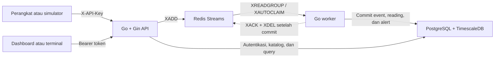

# IoT Environmental Monitoring & Alerting

Platform backend untuk menerima pembacaan CO₂, suhu, dan kelembapan dari perangkat IoT. API Go/Gin mengelola perangkat dan sensor, menerima event melalui Redis Streams, serta menyajikan histori, agregasi, alert, dan status koneksi. Worker Go menyimpan data ke PostgreSQL 17 dengan ekstensi TimescaleDB.

## Yang bisa dicoba

- Daftarkan perangkat dan beberapa sensor, rotasi ID publik atau API key, dan aktifkan atau nonaktifkan perangkat.
- Kirim pengukuran dengan `X-API-Key`. Backend memeriksa nilai, tipe sensor, dan kepemilikannya, lalu mencegah penyimpanan duplikat saat event dikirim ulang.
- Lihat histori dan agregasi per menit atau jam dengan rata-rata, minimum, maksimum, dan jumlah sampel.
- Buat aturan alert per sensor dengan ambang pemicu dan pemulihan. Pantau status perangkat melalui heartbeat dan timeout aktivitas.

## Arsitektur



`202 Accepted` berarti event berhasil masuk Redis. Worker menyimpan event dan pembacaan serta mengevaluasi alert secara asinkron. Jika kiriman perlu diulang, gunakan `event_id` dan payload yang sama. Worker memakai pasangan `(device_id, event_id)` dan hash payload untuk membedakan replay identik dari konflik isi.

`sensor_readings` adalah hypertable dengan chunk harian berdasarkan `recorded_at`. Endpoint agregasi menghitung data yang sudah tersimpan dengan PostgreSQL `date_bin`, `AVG`, `MIN`, `MAX`, dan `COUNT`.

## Jalankan dari clone baru

Diperlukan **Docker Desktop** atau **Docker Engine dengan Compose v2**. PowerShell 7 dipakai untuk contoh Windows dan runner pengujian. Go **1.27.4** diperlukan jika menjalankan dashboard atau tes Go secara lokal. Compose membangun backend di dalam Docker.

```bash
git clone https://github.com/rillyayidan/iot-environment-monitoring.git
cd iot-environment-monitoring
```

### 1. Buat konfigurasi lokal

Pilih satu blok sesuai terminal. Keduanya membuat `.env` hanya jika file belum ada dan mengisi dua nilai acak. `POSTGRES_PASSWORD` dipakai untuk koneksi database, sedangkan `ADMIN_TOKEN` adalah Bearer token operator. Perangkat mendapat API key sendiri ketika didaftarkan. `.env` diabaikan Git.

<details>
<summary>Windows PowerShell 7</summary>

```powershell
if (-not (Test-Path -LiteralPath '.env')) {
    $dbPassword = [Convert]::ToHexString([Security.Cryptography.RandomNumberGenerator]::GetBytes(32))
    $operatorToken = [Convert]::ToHexString([Security.Cryptography.RandomNumberGenerator]::GetBytes(32))
    $template = Get-Content -LiteralPath '.env.example' -Raw
    $template -replace '(?m)^POSTGRES_PASSWORD=[^\r\n]*', "POSTGRES_PASSWORD=$dbPassword" `
              -replace '(?m)^ADMIN_TOKEN=[^\r\n]*', "ADMIN_TOKEN=$operatorToken" |
        Set-Content -LiteralPath '.env' -Encoding ascii
}
```

</details>

<details>
<summary>macOS atau Linux dengan Bash dan OpenSSL</summary>

```bash
if [ ! -e .env ]; then
    (
        set -eC
        umask 077
        password=$(openssl rand -hex 32)
        token=$(openssl rand -hex 32)
        sed -e "s/^POSTGRES_PASSWORD=.*/POSTGRES_PASSWORD=$password/" \
            -e "s/^ADMIN_TOKEN=.*/ADMIN_TOKEN=$token/" .env.example > .env
    )
fi
```

</details>

### 2. Nyalakan layanan dan cek kesiapan

```bash
docker compose up --build --wait
docker compose ps -a
```

Compose menjalankan PostgreSQL, Redis, migrasi, API, dan worker. Service `migrate` berhenti dengan **`Exited (0)`** setelah berhasil. API dan worker baru dijalankan setelah PostgreSQL dan Redis siap serta migrasi sukses.

Cek readiness API dengan salah satu perintah berikut.

```powershell
Invoke-RestMethod 'http://127.0.0.1:8080/health/ready'
```

```bash
curl -fsS http://127.0.0.1:8080/health/ready
```

Respons yang diharapkan adalah `{"status":"ready"}`. Port host bawaan adalah API **8080**, PostgreSQL **5433**, dan Redis **6379**. Jika port sudah dipakai, sesuaikan `API_PORT`, `POSTGRES_PORT`, atau `REDIS_PORT` di `.env` dan gunakan port baru pada perintah yang berjalan di host.

### 3. Coba demo

**Dashboard di browser.** Jalankan perintah berikut dari root repo dan buka [http://127.0.0.1:8090/](http://127.0.0.1:8090/).

```bash
go run ./demo-ui
```

1. Klik **Hubungkan token** dan tempel nilai `ADMIN_TOKEN` dari `.env`.
2. Klik **Siapkan perangkat demo**. Dashboard membuat satu perangkat, tiga sensor, dan satu aturan alert per sensor.
3. Klik **Kirim heartbeat**, lalu lihat status berubah dari `NEVER_SEEN` ke `ONLINE`.
4. Klik **Kirim pembacaan tinggi**. Setelah worker menyimpan event, histori berisi tiga reading dan ketiga alert menjadi `ACTIVE`.
5. Klik **Ulangi event terakhir**. Event ID tetap sama dan histori tetap berisi tiga reading untuk event tersebut. Pilih **Per menit** dan **Per jam** untuk melihat hasil agregasi.
6. Klik **Kirim pembacaan pemulihan**. Setelah event diproses, alert yang sama menjadi `RESOLVED`.

Dashboard berjalan sebagai proses lokal. Jika port 8090 sudah dipakai dashboard, buka alamat tersebut. Untuk port lain, gunakan `go run ./demo-ui -port 8091`. Jika port API diubah, tambahkan `-api-port <port>`. Tekan **Ctrl+C** di terminal dashboard untuk menghentikannya.

**Demo Bash.** Pada macOS atau Linux dengan `curl`, `jq`, dan `uuidgen`, jalankan `bash scripts/demo.sh` setelah Compose siap. Skrip membuat satu perangkat dan satu sensor CO₂, lalu memeriksa heartbeat, replay, dan transisi alert. Demo ini dapat dijalankan tanpa Go lokal.

Untuk alur lengkap 10 requirement, termasuk pembuktian lewat HTTP, SQL, dan hasil k6, gunakan [Panduan Demo IoT](docs/Panduan%20Demo%20IoT.md).

### 4. Hentikan layanan

```bash
docker compose down
```

Named volume `timescale-data` dan `redis-data` menyimpan data saat container dibuat ulang. Pakai kembali `.env` yang sama pada startup berikutnya.

## Pengujian

Jalankan unit test dari root repo dengan Go.

```powershell
go test -count=1 -v ./internal/ingest ./internal/alert ./internal/handler
```

Integration test memakai PostgreSQL dengan TimescaleDB dan Redis nyata. Set `TEST_DATABASE_URL` dan `TEST_REDIS_URL` sebelum menjalankan `go test -count=1 -v ./integration`. Suite dilewati jika kedua URL kosong. Petunjuk lengkap untuk integration test, race detector, benchmark k6, dan recovery ada di [Panduan Pengujian](docs/testing.md).

Pada pengujian lokal 1.000 perangkat selama 60 detik setelah migrasi TimescaleDB, API menerima **66.458 request** dengan **0% error** dan **p99 8,34 ms**. Setelah antrean kosong, **60.783 event unik** dan **182.349 pembacaan** ditemukan di PostgreSQL tanpa duplikat. Ini hasil satu skenario lokal. Skrip k6 menyimpan bukti mentah ke `artifacts/`, yang diabaikan Git. Lihat [Panduan Demo](docs/Panduan%20Demo%20IoT.md#7-concurrent-requests-dan-bukti-beban) dan [Laporan Pengujian](docs/test-report.md) untuk konteks dan hasil sebelum dan sesudah batching.

## Referensi

| Berkas | Isi |
| --- | --- |
| [OpenAPI 3.1](docs/openapi.json) | Kontrak 23 operasi HTTP dalam 18 path. Impor file JSON ke Swagger Editor untuk menelusuri parameter, body, autentikasi, dan respons. |
| [Panduan Demo IoT](docs/Panduan%20Demo%20IoT.md) | Langkah demo untuk 10 requirement, hasil yang harus terlihat, serta file dan fungsi yang bertanggung jawab. |
| [Panduan Pengujian](docs/testing.md) | Cara menjalankan tes Go, k6, dan simulasi gangguan dependency. |
| [Laporan Pengujian](docs/test-report.md) | Hasil terukur, perbandingan batching, dan lokasi bukti. |
| [Dashboard demo](demo-ui/README.md) | Cara menjalankan dashboard dan penjelasan preset sensor. |

### Struktur kode

| Folder | Tanggung jawab |
| --- | --- |
| `cmd/api` dan `cmd/worker` | Titik masuk proses HTTP, ingestion worker, dan monitor perangkat. |
| `internal/router` dan `internal/handler` | Rute Gin, middleware kredensial, parsing request, dan respons HTTP. |
| `internal/catalog`, `internal/ingest`, `internal/history`, `internal/alert`, `internal/monitor` | Aturan bisnis dan akses PostgreSQL. |
| `internal/stream` dan `migrations` | Redis Streams serta perubahan skema PostgreSQL. |
| `integration` dan `scripts` | Tes Go dengan dependency nyata, benchmark k6, dan pengujian recovery. |

## Pemecahan masalah

- **API belum siap atau migrasi gagal.** Jalankan `docker compose ps -a` dan `docker compose logs --tail 30 migrate`. `Exited (0)` menunjukkan migrasi sukses. Jika giliran startup berhenti pada `Exited (1)`, baca error di log migrasi sebelum mencoba lagi.
- **Browser menampilkan `404` di port 8080.** Port tersebut melayani API. Cek `/health/ready` atau buka dashboard di port 8090.
- **`password authentication failed` setelah mengganti `.env`.** Pada volume yang sudah ada, PostgreSQL masih memakai password akun yang tersimpan. Pakai kembali nilai sebelumnya, atau sinkronkan password akun jika ingin menggantinya.

<details>
<summary>Sinkronkan POSTGRES_PASSWORD tanpa menghapus volume melalui PowerShell</summary>

Setelah menyimpan password baru berbentuk heksadesimal di `.env`, jalankan langkah berikut dari root repo. `\password` memperbarui akun dengan nilai environment container.

```powershell
docker compose stop api worker
docker compose up -d --wait postgres
if ($LASTEXITCODE -ne 0) { throw 'PostgreSQL belum siap.' }

docker compose exec -T postgres sh -ec 'test -n "$POSTGRES_PASSWORD"; printf "%s\n%s\n" "$POSTGRES_PASSWORD" "$POSTGRES_PASSWORD" | psql -X -v ON_ERROR_STOP=1 -U "$POSTGRES_USER" -d "$POSTGRES_DB" -c "\\password"'
if ($LASTEXITCODE -ne 0) { throw 'Password PostgreSQL gagal diperbarui.' }

docker compose up --wait
Invoke-RestMethod 'http://127.0.0.1:8080/health/ready'
```

</details>

<details>
<summary>Jika membawa data dari stack PostgreSQL lama</summary>

Ambil dump dari container PostgreSQL lama sebelum merekreasinya. Hentikan API, tunggu stream Redis kosong, lalu hentikan worker agar dump mencakup event yang sudah diterima. Pulihkan dump ke database TimescaleDB baru yang masih kosong sebelum menjalankan migrasi. Jalankan `docker compose run --rm --no-deps migrate` setelah PostgreSQL baru sehat dan data sudah dipulihkan, lalu jalankan `docker compose up --build --wait`. Migrasi `000006` mengonversi data reading yang sudah ada. Simpan volume lama dan dump sampai hasil verifikasi cocok.

```powershell
docker compose exec -T postgres psql -X -U iot_user -d iot_monitor `
    -c 'SELECT version, dirty FROM schema_migrations;' `
    -c "SELECT extversion FROM pg_extension WHERE extname = 'timescaledb';" `
    -c "SELECT hypertable_name, num_chunks FROM timescaledb_information.hypertables WHERE hypertable_schema = 'public';"
```

</details>

